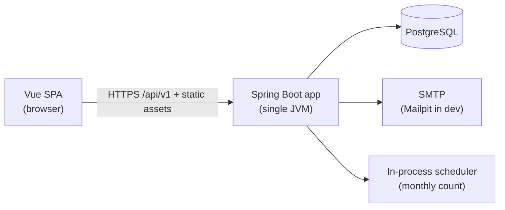
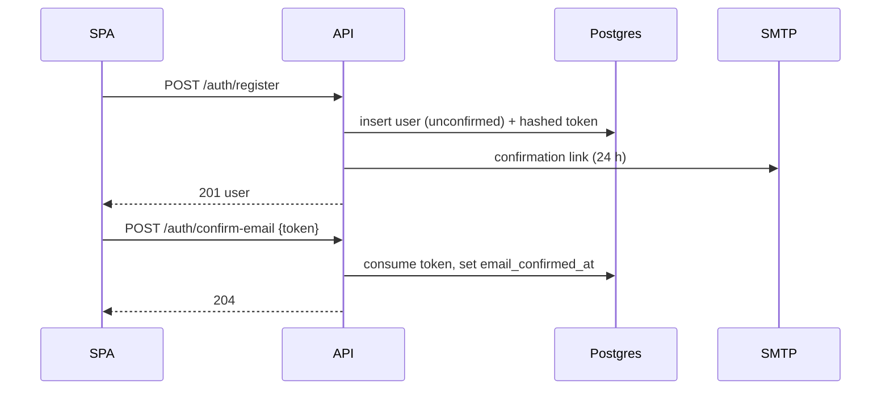
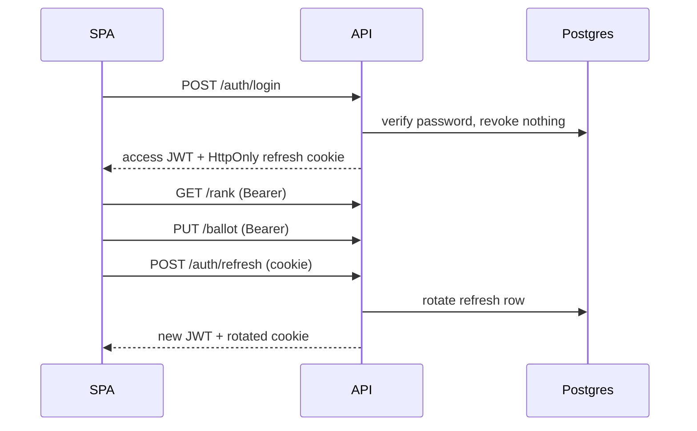
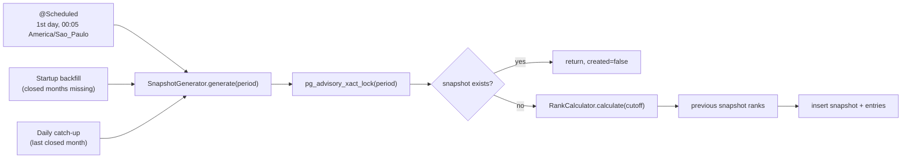

# Architecture

Last reviewed: 2026-11-01 · Status: draft, authoritative for system design

Domain rules live in [overview.md](overview.md); HTTP shapes live in
[api.md](api.md); tables live in [data-model.md](data-model.md). This file
decides how the system is put together.

## Context



One deployable: Spring Boot serves the built SPA and the JSON API from the same
origin. There is no reverse-proxy routing between two apps, no separate client
host and therefore no CORS configuration. PostgreSQL is the only store. Email is
the only outbound integration. The count scheduler runs inside the application
process.

## Baseline

Accounts and sessions are implemented (M1): email/password registration,
confirmation and reset mail, JWT access tokens, rotated refresh cookies, logout,
`/auth/me`, Flyway auth migrations, Mailpit in Compose and integration tests
against Testcontainers. Characters, ballot writes and the live rank are
implemented (M2), including the sample catalog, search, detail, ranking math and
the vote editor. Monthly and annual snapshots are still specification-only (M3).
See [roadmap.md](roadmap.md) for the current gap list; do not assume a capability
exists because a dependency is present.

Verify framework APIs against the versions actually resolved by the build
(`./mvnw dependency:tree`, the local JDK's docs, the installed `node_modules`)
before writing code from memory. Spring Boot 4 and Spring Security 7 differ from
the tutorials most agents have memorized.

## Repository layout

```text
/
├── AGENTS.md              # agent entry point (read first)
├── README.md              # human quickstart
├── docs/                  # specifications (this folder)
├── api/                   # Spring Boot application
│   ├── pom.xml
│   ├── compose.yaml       # Postgres (+ Mailpit to add)
│   └── src/
│       ├── main/java/rocks/leug/turmadamonicarank/
│       ├── main/resources/db/migration/
│       └── test/java/rocks/leug/turmadamonicarank/
└── client/                # Vue SPA
    ├── package.json
    ├── index.html
    └── src/
```

`api/src/main/resources/static/` is a build output for the packaged SPA. It is
not hand-edited and not committed.

## Backend modules

Package by feature under `rocks.leug.turmadamonicarank`. A feature package owns
its controller, service, repositories, entities and DTOs. Controllers stay thin;
services own transactions and invariants; repositories own queries.

```text
config/       security, JWT, clock, mail, scheduling, SPA fallback, Jackson
common/       problem+json advice, ApiErrorCode, pagination, time periods
auth/         registration, confirmation, sessions, refresh rotation, reset
mail/         EmailSender seam and its adapters/templates
user/         User entity, profile reads
character/    characters, aliases, search, detail, history
ballot/       ballot + entries, read/replace/withdraw
rank/         live rank query and read endpoint
snapshot/     period math, generator, backfill, scheduler, read endpoints
```

Dependency direction: `config → feature`, `feature → common`, and
`feature → another feature's service` only through the interfaces listed
below. Never inject another feature's repository into a feature. `rank` is the
single exception to owning its data: its read query joins ballots, characters
and snapshots directly, because the ranking is a projection across those
tables. Keep that query inside `rank`.

### Modules and seams

These are the interfaces worth protecting. They are deliberately small; the
behaviour behind them is where the complexity lives.

| Module | Interface | Hides | Adapters |
| --- | --- | --- | --- |
| `rank.RankCalculator` | `Ranking calculate(Instant cutoff)` (`null` = live) | Scoring, active filter, deterministic ordering, aggregation SQL | Postgres |
| `snapshot.SnapshotGenerator` | `SnapshotOutcome generate(YearMonth period)` | Advisory lock, cutoff, idempotency, previous ranks, inserts | Postgres |
| `snapshot.YearSnapshotGenerator` | `YearSnapshotOutcome generate(Year year)` | Yearly lock, idempotency, aggregation, frozen rows | Postgres |
| `ballot.BallotService` | `Optional<BallotView> current(UserId)`, `BallotView replace(UserId, List<UUID>)`, `void withdraw(UserId)` | Validation, confirmation gate, atomic replacement, timestamps | Postgres |
| `auth.RegistrationService` | `UserSelf register(...)`, `void confirm(String token)`, `void resend(String email)` | Token issuing, hashing, mail dispatch, enumeration-safe responses | Postgres + mail |
| `auth.SessionService` | `TokenResponse login(...)`, `TokenResponse refresh(...)`, `void logout(...)` | Password check, rotation, reuse detection, cookie payloads | Postgres |
| `auth.PasswordResetService` | `void request(String email)`, `void reset(String token, String password)` | Token lifecycle, session revocation, enumeration safety | Postgres + mail |
| `auth.JwtService` | `IssuedAccessToken issue(User)` | JWT claims, signing, TTL | HS256 |
| `mail.EmailSender` | `void send(EmailMessage)` | SMTP details, templates, dev/test delivery | SMTP, recording |
| `character.CharacterDirectory` | `PageResponse<CharacterSummary> search(...)`, `CharacterDetail detail(String slug)` (history in M3) | Search SQL, accent handling, current rank | Postgres |
| `common.SnapshotPeriods` | `Instant cutoff(YearMonth)`, `YearMonth currentPeriod(Instant)`, `Instant nextCutoff(Instant)` | Zone (`America/Sao_Paulo`), month-end math | `Clock` |

Rules:

- The interface is the test surface. Test a module through it; do not reach into
  its implementation with mocks unless the module composes a real external
  adapter (mail, clock).
- `EmailSender` earns its seam because it has two real adapters (SMTP and a
  recording fake). `Clock` earns its seam because the count job and its tests
  need controllable time.
- Do not add a `…Service` that only delegates to one repository. Either it owns
  a rule/transaction, or the read query belongs to a repository projection the
  controller calls.
- `RankCalculator` returns the whole ordered ranking; the live endpoint slices
  it for pagination and the snapshot generator consumes it whole. Keep the SQL
  in one place, and revisit only when measured.
- `SnapshotGenerator` is the only writer of snapshot rows. No other module
  inserts, updates or deletes them.

## Authentication and sessions

### Register and confirm



Tokens are 32 random bytes, base64url-encoded for the link, stored only as
SHA-256. A new token of the same purpose consumes outstanding ones. The link
points at the SPA (`{app.web.base-url}/confirmar-email?token=…`), which posts the
token to the API; the API never renders HTML pages for auth.

### Login, refresh, logout



- The security filter chain is stateless: no `HttpSession`, no server-side
  session store. It validates the bearer JWT with the shared HS256 secret and
  maps `sub` to a `UserId`.
- Refresh tokens are deliberately opaque and database-backed so they can be
  rotated and revoked. They are never JWTs. Reuse detection revokes the family
  and returns 401; that revocation must commit even though the request failed,
  so the rotation transaction uses `noRollbackFor = ApiException.class`.
- `SameSite=Lax` plus a scoped cookie path prevents cross-site use. A small
  filter rejects requests carrying the refresh cookie when the `Origin` header
  is present and differs from `app.web.base-url`, as defense in depth. The API
  sets no CORS headers, ever.
- Authorization for ballot writes loads the user and checks
  `email_confirmed_at`; the token is identity only and its claims are never
  authorization state.
- The client keeps the access token in memory and performs a single-flight
  refresh on `401`, retrying the original request once. See the client section.
- Known multi-tab caveat: two tabs refreshing at the same instant can present the
  same token twice, which reuse detection treats as theft and revokes the
  family. The per-tab single flight does not cross tabs. This is accepted for
  now; see OQ-011 for the grace-window fix if it becomes a real complaint.

### Password reset

`request` always answers `202`, consumes any outstanding reset token, and mails
a 1-hour link when the account is active. `reset` consumes the token, stores the
new hash and revokes every refresh token of the user. Confirmation and reset
tokens share the `auth_tokens` table and differ by `purpose`.

## The count

The count is the monthly snapshot pipeline.



- Period math is centralized in `SnapshotPeriods`; the scheduler, generator and
  API all use it, never `LocalDate.now()` or ad-hoc `ZoneId` calls.
- Cutoff: last day of the period, 23:59:59.999 in `America/Sao_Paulo`. The
  aggregation excludes ballots whose `updated_at` is after the cutoff.
- Idempotency: a transaction-scoped advisory lock keyed by the period, an
  existence check inside the transaction, and the unique constraint as the final
  guard.
- The generator writes the snapshot and all entries in one transaction. It
  computes ordinal positions with `ROW_NUMBER()` using the same ordering as the
  live rank. Previous ranks are joined from the previous period's snapshot.
  Eligible voters are active accounts; disabled accounts' ballots are excluded,
  and the same joins drive `totalBallots`.
- The generator returns `created=false` on a repeat run rather than failing.
- Schedule: `0 5 0 1 * *` with `zone = "America/Sao_Paulo"` (00:05 on the first
  day, five minutes after the cutoff). Why five minutes: it lets late commits
  land while the `updated_at` filter keeps the cutoff exact. The scheduler
  generates the period that just closed (`currentPeriod(clock.instant())
  .minusMonths(1)`), not the month that just began.
- Startup backfill and a daily catch-up generate missing already-closed periods,
  oldest first, so `previous_rank` chains correctly. The range starts at the
  month of the earliest ballot (`min(ballots.created_at)`) and ends at the most
  recently closed period; with no ballots there is nothing to backfill.
  Failures are logged at `ERROR` with the period and cause, and do not prevent
  the application from serving reads. There is no silent recomputation of
  existing snapshots.
- Single-instance assumption: one JVM runs the scheduler. Multiple instances
  need a distributed scheduler lock and a decision entry.

`SnapshotBackfill` and the daily check call `SnapshotGenerator`; they contain no
ranking logic of their own.

### Annual snapshots

After the December monthly snapshot is written, `YearSnapshotGenerator.generate`
aggregates that closed year's monthly snapshots and freezes `year_snapshots` plus
`year_snapshot_entries`. It runs at 00:06 on 1 January local time, takes an
advisory lock per year and is idempotent. Startup/daily backfill includes closed
years that have monthly snapshots but no annual snapshot, oldest first. A year
without monthly snapshots gets no annual row and the API reports `EMPTY`.

The year rank is ordered by average position, then latest position, then
normalized character name. The API serves frozen data for closed years and a
provisional, clearly marked rollup for the current year.

## HTTP layer

- REST controllers under `/api/v1`, one per resource, returning DTO records.
  Entities never cross the HTTP boundary.
- `@RestControllerAdvice` turns validation and domain exceptions into RFC 9457
  problems (`application/problem+json`) with the `code` values in
  [api.md](api.md). Controllers do not build error responses by hand.
- Request validation uses Jakarta Validation on request records; cross-field and
  database-dependent validation lives in the service.
- Unknown JSON properties are rejected (`FAIL_ON_UNKNOWN_PROPERTIES`).
- Pagination is a small value object (`PageRequest` with `limit`/`offset` and
  caps) built from query parameters, and a `PageResponse` envelope.
- Route patterns constrain path variables: `{year:[0-9]{4}}`,
  `{month:[0-9]{1,2}}`, slug `{slug:[a-z0-9-]+}`. Literal routes such as
  `/snapshots/latest` therefore cannot be shadowed by variables.
- Cache headers are set per endpoint as documented in [api.md](api.md). Public
  reads may be cached; auth and ballot responses are `no-store`.
- `/actuator/health` is the only exposed actuator endpoint.

## Persistence

- Migrations own the schema; Hibernate validates it. `spring.jpa.hibernate.ddl-auto=validate`,
  `spring.jpa.open-in-view=false`.
- Transactions live on service methods. `BallotService.replace` is a single
  transaction (delete entries, insert new ones, touch the ballot, flush) so a
  failure cannot leave a half-saved ballot.
- Read endpoints use projections (records built by JPQL/`JdbcClient`) instead of
  loading entity graphs. No N+1 queries; list endpoints paginate in SQL.
- All times come from the injected `Clock`. Services never call
  `Instant.now()`, `LocalDate.now()` or `new Date()`.
- Writes set `updated_at` explicitly from the `Clock` on users, characters and
  ballots. `ballots.updated_at` is the cutoff truth, so ballot mutations are
  never performed with bulk JPQL; they go through `BallotService`.
- Use `JdbcClient` (Spring's built-in) for the rank and history projections;
  the aggregation is clearer than Criteria/JPQL and keeps the ordering next to
  the SQL.
- Repositories return `Optional`, never `null`.

## Client architecture

The SPA is built with Vue 3 `<script setup>` + TypeScript, Vite, Tailwind v4
(`@tailwindcss/vite`) and Bun as the package manager.

```text
client/src/
├── main.ts                 # create app, router, pinia, boot session
├── App.vue
├── style.css               # @import "tailwindcss"; @theme design tokens
├── router/index.ts         # routes, guards, lazy page imports
├── pages/                  # one component per route
├── components/             # shared UI (Panel, Button, RankRow, Chart, …)
├── stores/auth.ts          # user + access token (memory) + boot state
├── lib/http.ts             # typed fetch client, refresh, problem+json errors
├── lib/types.ts            # hand-written API types mirrored from docs/api.md
├── lib/errors.ts           # API error code → pt-BR copy
├── lib/format.ts           # Intl pt-BR, rank labels, dates
└── lib/periods.ts          # countdown from nextCutoffAt
```

Installed client dependencies: Vue Router 5, Pinia 4, Tailwind v4 with
`@tailwindcss/vite`, self-hosted Baloo 2 / Nunito Sans font subsets, and Vitest
with Vue Test Utils and jsdom for unit tests. No UI kit, no chart library, no
axios:

- **HTTP client** — `lib/http.ts` is a deep module: callers get typed
  `get/put/post/delete` that attach the bearer token, add a request timeout,
  parse `application/problem+json` into a typed `ApiError`, and on `401` run one
  shared refresh and retry once. The store and pages never see raw `fetch`
  options. Auto-refresh is disabled for the auth endpoints themselves.
- **Auth store** — states: `restoring → anonymous | authenticated`, with
  `emailConfirmed` derived from `user`. On boot it calls `/auth/refresh` once
  (the cookie is the only persisted credential); success yields a token and
  user, failure yields anonymous. Login stores the token in memory only.
- **Router guards** — `requiresAuth` redirects to `/entrar?redirect=<path>` and
  restores the route after login; `requiresConfirmed` sends unconfirmed users to
  `/conta` with a confirmation banner. Guards wait for `restoring` to finish so
  reloads do not flash the login page.
- **Data fetching** — pages fetch through `lib/http` with local `ref`s for
  loading, data and error, and render retry and empty states. There is no global
  server cache in the MVP; navigating reloads. Extract a shared composable only
  when a third page needs the same state machine.
- **Ballot editor** — `VotePage` owns the ordered draft, validation hints and a
  dirty flag, with `beforeunload` and route-leave guards. Moving that state into
  a `stores/ballot.ts` so it also survives a login round-trip is M4 work.
- **Styling** — Tailwind v4 with tokens declared in `@theme` in `style.css`
  (see [ui.md](ui.md)); no ad-hoc hex values in components. Components use
  tokens and utility classes only.
- **Types** — hand-written TypeScript types in `lib/types.ts` mirroring
  [api.md](api.md). No generated client in the MVP; the contract tests keep the
  server honest and the types are reviewed against the doc.

The client does not compute points, ranks, periods or cutoffs. It displays what
the API returns and formats it for pt-BR. The only time math it does is a
cosmetic countdown from `nextCutoffAt`, and it renders the server's label for the
period.

### Static serving and SPA fallback

- `bun run build` emits `client/dist`.
- A Maven profile `ui` copies `client/dist/**` into `target/classes/static`
  during `process-resources`, so `./mvnw -Pui package` produces a single jar
  once the client has been built. The default backend build does not require
  Bun.
- A fallback controller serves `index.html` for browser routes that are not
  `/api/**`, `/actuator/**` or a real static asset. It must not swallow API 404s
  or asset 404s: `/api/v1/nope` still returns a problem+json `NOT_FOUND`.
- Vite dev server proxies `/api` to `http://localhost:8080`; there is no CORS
  filter anywhere. The SPA uses a relative base URL (`/api/v1`) by default and
  `VITE_API_BASE_URL` only if deployment demands it.

## Configuration

`application.yaml` holds non-secret defaults; `application-local.yaml` holds
local values (run with `SPRING_PROFILES_ACTIVE=local`); production is configured
by environment variables. Secrets never enter the repository.

| Property | Environment variable | Local default |
| --- | --- | --- |
| `app.web.base-url` | `APP_WEB_BASE_URL` | `http://localhost:5173` |
| `app.security.jwt.secret` | `JWT_SECRET` | dev-only literal in `application.yaml` |
| `app.security.jwt.access-ttl` | — | `10m` |
| `app.security.auth.refresh-ttl` | — | `30d` |
| `app.security.auth.confirmation-ttl` | — | `24h` |
| `app.security.auth.reset-ttl` | — | `1h` |
| `app.security.auth.refresh-cookie-secure` | `APP_REFRESH_COOKIE_SECURE` | `false` locally, `true` in production |
| `app.mail.from` | `APP_MAIL_FROM` | `Turma da Mônica Rank <no-reply@localhost>` |
| `app.rank.zone` | `APP_RANK_ZONE` | `America/Sao_Paulo` |
| `app.rank.snapshot-cron` (M3) | — | `0 5 0 1 * *` |
| `spring.datasource.url` | `SPRING_DATASOURCE_URL` | from Compose |
| `spring.datasource.username` | `SPRING_DATASOURCE_USERNAME` | `myuser` |
| `spring.datasource.password` | `SPRING_DATASOURCE_PASSWORD` | `secret` |
| `spring.mail.host` / `port` | `SPRING_MAIL_HOST` / `SPRING_MAIL_PORT` | `localhost` / `1025` |
| `spring.jpa.hibernate.ddl-auto` | — | `validate` |
| `spring.jpa.open-in-view` | — | `false` |
| `spring.jackson.default-property-inclusion` | — | `always` |
| `management.endpoints.web.exposure.include` | — | `health` |

Local development uses `api/compose.yaml` with pinned Postgres and Mailpit
(SMTP `1025`, UI `8025`). Spring Boot's Docker Compose support starts the
services when Docker is available; the app also works when `SPRING_DATASOURCE_*`
points at an existing database. Use `SPRING_PROFILES_ACTIVE=local` for the
development mail and cookie settings.

JWT: HS256 with a secret of at least 32 bytes, `iss=turmadamonicarank`,
`aud=turmadamonicarank-web`. Rotating the secret invalidates all access tokens;
refresh tokens survive because they are opaque. In the `prod` profile the
application must refuse to start when `JWT_SECRET` is missing, too short, or the
key is known to be a development value.

Logging: Spring Boot structured logging (ECS or GELF) in production; plain
console locally. Never log request bodies for auth endpoints, tokens, cookies or
passwords.

## Security posture

- Stateless API; security headers: CSP (`default-src 'self'; img-src 'self' data:
  https:; style-src 'self' 'unsafe-inline'; script-src 'self'; connect-src
  'self'; font-src 'self'; frame-ancestors 'none'; base-uri 'self';
  form-action 'self'`), `X-Content-Type-Options: nosniff`, `Referrer-Policy:
  strict-origin-when-cross-origin`, `Permissions-Policy` minimal, HSTS in
  production. The `style-src 'unsafe-inline'` allowance exists for component
  style bindings; scripts stay strict.
- Refresh-cookie endpoints validate `Origin` when present.
- Spring Security's CSRF filter is disabled for `/api/**`: authentication is
  bearer-based for state-changing API calls, and the only cookie endpoint
  (`/auth/refresh`, `/auth/logout`) is `SameSite=Lax` and `Origin`-checked. Do
  not enable cookie-authenticated writes without adding CSRF tokens.
- Rate limiting (M5): an in-memory token bucket per IP and, for login, per
  email, on auth endpoints only. A single instance makes an in-memory bucket
  honest.
- Emails are normalized before storage; passwords are never trimmed or
  normalized. BCrypt cost 12, or Argon2id if it is adopted globally.
- HTML email templates escape user-controlled values (display name only).
- Tests cover the authorization matrix; a new endpoint without a 401/403 test is
  incomplete.

## Testing strategy

| Layer | Tools | What it proves |
| --- | --- | --- |
| Pure unit | JUnit 5, AssertJ | Period math, ranking comparator edge cases, token TTLs, draft logic |
| Web slice | `@WebMvcTest`, security test support | Contract shapes, statuses, error codes, authorization matrix |
| Integration | `@SpringBootTest` + Testcontainers Postgres | Migrations, repositories, ballot atomicity, generator idempotency, cutoff filtering |
| Client unit | Vitest + jsdom | HTTP retry, auth-store refresh single-flight, error mapping, formatting and countdowns |

Conventions:

- A test `Clock` bean (mutable, fixed instant) is the only way services get
  time. Snapshot tests move the clock past a cutoff and assert the ballot's
  `updated_at` boundary.
- Mail tests use the recording `EmailSender` and assert the link and token
  purpose; no SMTP in tests.
- Integration tests run Flyway against Postgres and use transactional rollback
  between cases, so the seeded characters stay available. No H2, ever. Disable
  the scheduler and the startup backfill in the test profile so a test run cannot
  generate snapshots behind a test's back.
- Snapshot tests cover: empty month, first snapshot (`previous_rank` null),
  ranking change between periods, repeat run (`created=false`), and a ballot
  edited after the cutoff.
- `./mvnw verify` must pass before a change is considered done; `bun run test`
  and `bun run build` cover client changes. GitHub Actions runs the same checks
  for every pull request (`.github/workflows/ci.yml`).

## Performance and scaling notes

- Live rank: one aggregate query per cache window. A small in-memory TTL cache
  (30–60 s) in `RankService` is enough; no cache server, no new dependency.
- All list queries are indexed and paginated in SQL. Character search uses
  trigram indexes and a query length floor.
- Snapshot generation is O(ballots) once a month, inside one transaction; with
  tens of thousands of ballots it remains a sub-second-to-few-seconds job.
- The client bundle stays small: no UI kit, no chart library, vendored fonts
  limited to two weights per family.

## Out of the architecture deliberately

- No CORS, no API gateway, no separate auth service, no Redis, no message
  broker, no SSR, no microservices, no H2.
- No admin API; character data is seed-owned.
- No client-side computed ranking. If the UI needs a new ranking view, add a
  server projection.
