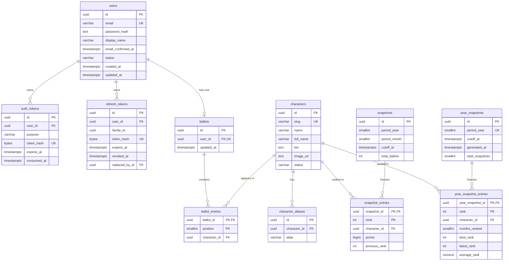

# Data model

Last reviewed: 2026-11-01 · Status: draft, authoritative for schema

PostgreSQL is the only database. Flyway migrations are the only schema
authority; Hibernate runs with `ddl-auto: validate`. Domain rules (points,
ordering, cutoff, immutability) are defined in
[overview.md](overview.md#how-the-ranking-works) and are not repeated here.

## Entity relationships



## Conventions

- Tables and columns are `snake_case`; primary keys are `uuid` with
  `default gen_random_uuid()`; names are English.
- All instants are `timestamptz`, stored and compared in UTC. Month boundaries
  are computed in `America/Sao_Paulo` before comparing.
- Money-like precision is unnecessary; counts are `integer`, points `bigint`
  (max 10 points × ballot count).
- `created_at` and `updated_at` are `not null default now()`. The application
  writes `updated_at` from the injected `Clock` on every mutation of `users`,
  `characters` and `ballots`. No database trigger owns these columns, and no
  code bulk-updates `ballots`; the cutoff filter depends on this.
- Email addresses are trimmed, lowercased in the application and stored as
  `varchar(254)` with a unique constraint. The lowercase value is the canonical
  identity; no case-insensitive type extension is used.
- Characters are never hard-deleted; use `status = 'INACTIVE'`.
- Text is UTF-8 and holds Portuguese accents. Search normalization happens in
  SQL, not in application memory.

## Extensions

`V1__extensions_and_helpers.sql` creates:

```sql
CREATE EXTENSION IF NOT EXISTS pg_trgm;  -- trigram search indexes
CREATE EXTENSION IF NOT EXISTS unaccent; -- accent-insensitive search
```

`unaccent` is not `IMMUTABLE`, so it cannot be indexed directly. Add an
immutable wrapper in the same migration and use it in every expression index
and search query:

```sql
CREATE OR REPLACE FUNCTION immutable_unaccent(text)
RETURNS text
LANGUAGE sql
IMMUTABLE
PARALLEL SAFE
STRICT
AS $$ SELECT public.unaccent('public.unaccent', $1) $$;
```

If a managed Postgres refuses extensions, the fallback is: store emails
lowercased in `text` with a unique index, and drop trigram search to `ILIKE`
prefix search. Record that as a decision before implementing it.

## Tables

### `users`

| Column | Type | Rules |
| --- | --- | --- |
| `id` | `uuid` | PK, `gen_random_uuid()` |
| `email` | `varchar(254)` | not null, unique, trimmed and lowercased by the app |
| `password_hash` | `text` | not null, BCrypt/Argon2 output only |
| `display_name` | `varchar(60)` | nullable; when set, 2–60 chars |
| `email_confirmed_at` | `timestamptz` | null until confirmed; never cleared |
| `status` | `varchar(16)` | not null, default `ACTIVE`, check in (`ACTIVE`,`DISABLED`) |
| `created_at` | `timestamptz` | not null, default `now()` |
| `updated_at` | `timestamptz` | not null, default `now()`, app-managed |

Indexes: unique `email` (from the column), `status` for admin-less operation is
unnecessary.

### `auth_tokens`

One table for both email-confirmation and password-reset tokens.

| Column | Type | Rules |
| --- | --- | --- |
| `id` | `uuid` | PK |
| `user_id` | `uuid` | not null, FK `users(id)` on delete cascade |
| `purpose` | `varchar(32)` | not null, check in (`EMAIL_CONFIRMATION`,`PASSWORD_RESET`) |
| `token_hash` | `bytea` | not null, unique; SHA-256 of a 32-byte random token |
| `expires_at` | `timestamptz` | not null; 24 h confirmation, 1 h reset |
| `consumed_at` | `timestamptz` | null until used; single use |
| `created_at` | `timestamptz` | not null, default `now()` |

Indexes: `(user_id, purpose)`, `(expires_at)` for cleanup. Issuing a token marks
any unconsumed token of the same `(user_id, purpose)` as consumed first, so at
most one link is valid.

### `refresh_tokens`

| Column | Type | Rules |
| --- | --- | --- |
| `id` | `uuid` | PK |
| `user_id` | `uuid` | not null, FK `users(id)` on delete cascade |
| `family_id` | `uuid` | not null; constant across a login's rotations |
| `token_hash` | `bytea` | not null, unique; SHA-256 of the opaque token |
| `expires_at` | `timestamptz` | not null; 30 days from issue |
| `revoked_at` | `timestamptz` | null until revoked |
| `replaced_by_id` | `uuid` | nullable, self-FK on delete set null |
| `created_at` | `timestamptz` | not null, default `now()` |

Indexes: `(user_id)`, `(family_id)`, `(expires_at)`. Rotation inserts a new row,
then sets `revoked_at` and `replaced_by_id` on the old one in the same
transaction. Presenting a token that is already revoked revokes every
non-revoked row in its family.

### `characters`

| Column | Type | Rules |
| --- | --- | --- |
| `id` | `uuid` | PK |
| `slug` | `varchar(80)` | not null, unique, check `^[a-z0-9]+(-[a-z0-9]+)*$`; stable URL |
| `name` | `varchar(120)` | not null, display name |
| `full_name` | `varchar(160)` | nullable |
| `bio` | `text` | nullable, plain text, 200–800 characters recommended |
| `image_url` | `text` | nullable; self-hosted path (`/images/characters/{slug}.webp`) |
| `image_alt` | `varchar(200)` | nullable; required by UI when `image_url` is set |
| `image_credit` | `varchar(200)` | nullable; author/licence line |
| `source_url` | `text` | nullable; source for the bio |
| `first_appearance_year` | `smallint` | nullable, check 1900–2100 |
| `first_appearance_work` | `varchar(200)` | nullable, e.g. `Turma da Mônica` |
| `status` | `varchar(16)` | not null, default `ACTIVE`, check in (`ACTIVE`,`INACTIVE`) |
| `created_at` | `timestamptz` | not null, default `now()` |
| `updated_at` | `timestamptz` | not null, default `now()`, app-managed |

Indexes:

```sql
CREATE INDEX characters_name_trgm
  ON characters USING gin (lower(immutable_unaccent(name)) gin_trgm_ops);
CREATE INDEX characters_full_name_trgm
  ON characters USING gin (lower(immutable_unaccent(coalesce(full_name, ''))) gin_trgm_ops);
CREATE INDEX characters_status_idx ON characters (status);
```

### `character_aliases`

| Column | Type | Rules |
| --- | --- | --- |
| `id` | `uuid` | PK |
| `character_id` | `uuid` | not null, FK `characters(id)` on delete cascade |
| `alias` | `varchar(120)` | not null; case-insensitively unique per character |

Index: `unique (character_id, lower(alias))` plus a trigram index:

```sql
CREATE INDEX character_aliases_alias_trgm
  ON character_aliases USING gin (lower(immutable_unaccent(alias)) gin_trgm_ops);
```

Aliases cover spelling variants and nicknames ("Monica", "Mônica", "Baixinho").

### `ballots`

| Column | Type | Rules |
| --- | --- | --- |
| `id` | `uuid` | PK |
| `user_id` | `uuid` | not null, unique, FK `users(id)` on delete cascade |
| `created_at` | `timestamptz` | not null, default `now()` |
| `updated_at` | `timestamptz` | not null, default `now()`, set by the app on every save |

`unique (user_id)` enforces one ballot per user. Withdrawing a ballot deletes
the row and its entries.

### `ballot_entries`

| Column | Type | Rules |
| --- | --- | --- |
| `ballot_id` | `uuid` | not null, FK `ballots(id)` on delete cascade |
| `character_id` | `uuid` | not null, FK `characters(id)` on delete restrict |
| `position` | `smallint` | not null, check 1–10 |

Primary key `(ballot_id, position)`; unique `(ballot_id, character_id)`; index
`(character_id)`. Positions are contiguous from 1 to the ballot length; the
application enforces the 1–10 maximum and contiguity in one transaction. The
database enforces the axis limits, uniqueness and the FK.

### `snapshots`

| Column | Type | Rules |
| --- | --- | --- |
| `id` | `uuid` | PK |
| `period_year` | `smallint` | not null, check 2000–2100 |
| `period_month` | `smallint` | not null, check 1–12 |
| `cutoff_at` | `timestamptz` | not null; month end, `America/Sao_Paulo` |
| `generated_at` | `timestamptz` | not null; when the job actually wrote the row |
| `total_ballots` | `integer` | not null, check ≥ 0; ballots counted |
| `total_characters_ranked` | `integer` | not null, check ≥ 0 |

`unique (period_year, period_month)` is the idempotency guard.

### `snapshot_entries`

| Column | Type | Rules |
| --- | --- | --- |
| `snapshot_id` | `uuid` | not null, FK `snapshots(id)` on delete cascade |
| `rank` | `integer` | not null, check ≥ 1; ordinal position |
| `character_id` | `uuid` | not null, FK `characters(id)` on delete restrict |
| `points` | `bigint` | not null, check ≥ 0 |
| `first_place_votes` | `integer` | not null, check ≥ 0 |
| `ballot_count` | `integer` | not null, check ≥ 0 |
| `previous_rank` | `integer` | nullable, check ≥ 1; null when no previous snapshot |
| `character_name` | `varchar(120)` | not null; frozen display name |
| `character_slug` | `varchar(80)` | not null; frozen slug |
| `character_image_url` | `text` | nullable; frozen image |

Primary key `(snapshot_id, rank)`; unique `(snapshot_id, character_id)`. Index
`(character_id, snapshot_id)` for a character's history.

The denormalized name, slug and image are deliberate: history must render the
character as they were ranked, even if the character record is edited later.
Status and alt text are not frozen; snapshot and history reads join the current
character row for `status` and `imageAlt`. There is no `image_alt` column in the
snapshot because alt text is presentation metadata, not historical data.

Immutability is enforced by there being no update or delete code path for
snapshot rows. Do not add one for convenience. If hardening is wanted later, a
database trigger that raises on `UPDATE`/`DELETE` is the place to do it; tests
would then clean up through truncation at setup.


### `year_snapshots`

Frozen aggregate record for a closed year. Created only when the year has at
least one monthly snapshot.

| Column | Type | Rules |
| --- | --- | --- |
| `id` | `uuid` | PK |
| `period_year` | `smallint` | not null, unique, check 2000–2100 |
| `cutoff_at` | `timestamptz` | not null; end of the year in `America/Sao_Paulo` |
| `generated_at` | `timestamptz` | not null; when the job wrote the row |
| `total_snapshots` | `smallint` | not null, check 1–12; monthly snapshots aggregated |

`unique (period_year)` is the idempotency guard.

### `year_snapshot_entries`

| Column | Type | Rules |
| --- | --- | --- |
| `year_snapshot_id` | `uuid` | not null, FK `year_snapshots(id)` on delete cascade |
| `rank` | `integer` | not null, check ≥ 1; ordinal year position |
| `character_id` | `uuid` | not null, FK `characters(id)` on delete restrict |
| `months_ranked` | `smallint` | not null, check 1–12 |
| `best_rank` | `integer` | not null, check ≥ 1 |
| `latest_rank` | `integer` | not null, check ≥ 1; position in the latest month present |
| `average_rank` | `numeric(4,2)` | not null, check ≥ 1 |
| `character_name` | `varchar(120)` | not null; frozen display name |
| `character_slug` | `varchar(80)` | not null; frozen slug |
| `character_image_url` | `text` | nullable; frozen image |

Primary key `(year_snapshot_id, rank)`; unique `(year_snapshot_id, character_id)`;
index `(character_id, year_snapshot_id)`.

The year entry is also denormalized so a closed year page never depends on the
current character record. The year page is frozen only after the year closes;
the current year is computed provisionally by the API and marked `IN_PROGRESS`.

Generation: `YearSnapshotGenerator` runs after the December monthly snapshot
(00:06 on 1 January local time), aggregates that year's monthly snapshots, and
computes the ordinal rank from average rank ascending, then latest rank
ascending, then `lower(immutable_unaccent(character_name))` ascending. It is
idempotent and is included in startup/daily backfill for closed years. No code
path updates or deletes year snapshot rows.

## Query patterns

### Live rank

```sql
SELECT c.id, c.slug, c.name, c.image_url,
       SUM(11 - e.position)                                AS points,
       COUNT(*) FILTER (WHERE e.position = 1)              AS first_place_votes,
       COUNT(*)                                            AS ballot_count
FROM ballot_entries e
JOIN ballots b    ON b.id = e.ballot_id
JOIN users u      ON u.id = b.user_id AND u.status = 'ACTIVE'
JOIN characters c ON c.id = e.character_id AND c.status = 'ACTIVE'
GROUP BY c.id
HAVING SUM(11 - e.position) > 0
ORDER BY points DESC, first_place_votes DESC, ballot_count DESC, c.slug ASC;
```

The endpoint paginates this result in SQL (`LIMIT`/`OFFSET`) and also returns a
total count.

### Snapshot aggregation at a cutoff

Same query with `WHERE b.updated_at <= :cutoff` added before `GROUP BY`, then
`ROW_NUMBER() OVER (ORDER BY ...)` to produce the ordinal `rank`. Previous rank
comes from the immediately preceding snapshot:

```sql
LEFT JOIN snapshot_entries prev
       ON prev.character_id = ranked.character_id
      AND prev.snapshot_id = :previous_snapshot_id
```

A character absent from the previous snapshot gets `previous_rank = null`.

### Total ballots counted

```sql
SELECT count(*)
FROM ballots b
JOIN users u ON u.id = b.user_id AND u.status = 'ACTIVE'
WHERE b.updated_at <= :cutoff;
```

This is the same population used for points, so `total_ballots` always matches
the rows behind the entries. The snapshot aggregation therefore also includes
the `users` and `characters` status joins shown above.

### Year rollup and yearly snapshot

Aggregate `snapshot_entries` for the year joined to `snapshots`, grouping by
character and computing `months_ranked`, `best_rank`, the rank from the latest
month present, and the average of monthly positions. Order by the unrounded
average, then latest rank, then normalized name. For a closed year, freeze that
result with `ROW_NUMBER()` into `year_snapshot_entries`. For the current year,
the same query is returned live and marked `IN_PROGRESS`.

### Character history

Read `snapshot_entries` for the character joined to `snapshots`, ordered by
`(period_year, period_month)`. The API returns one item per snapshot in the
requested range, with `rank = null` for months where the character is absent.
Year-level history can later read `year_snapshot_entries` the same way.

### Search

```sql
WHERE lower(immutable_unaccent(c.name)) LIKE '%' || lower(immutable_unaccent(:q)) || '%'
   OR lower(immutable_unaccent(coalesce(c.full_name, ''))) LIKE '%' || ...
   OR EXISTS (SELECT 1 FROM character_aliases a
              WHERE a.character_id = c.id
                AND lower(immutable_unaccent(a.alias)) LIKE '%' || ...)
```

For a 3+ character query, also rank exact/prefix matches first and fall back to
`similarity()` with a threshold of 0.3. Keep this SQL in the character
repository; do not fetch all characters and filter in Java.

## Migrations

Location: `api/src/main/resources/db/migration`.

| File | Contents |
| --- | --- |
| `V1__extensions_and_helpers.sql` | Extensions and `immutable_unaccent` |
| `V2__users_and_auth.sql` | `users`, `auth_tokens`, `refresh_tokens` |
| `V3__characters.sql` | `characters`, `character_aliases`, search indexes |
| `V4__ballots.sql` | `ballots`, `ballot_entries` |
| `V5__snapshots.sql` | `snapshots`, `snapshot_entries` |
| `V6__year_snapshots.sql` | `year_snapshots`, `year_snapshot_entries` |
| `R__seed_characters.sql` | Idempotent character seed |

Rules:

- One concern per migration, `V{n}__lower_snake_description.sql`, integer
  versions without gaps.
- Never edit an applied migration, including one merged into `main`. Add a new
  one.
- Do not put seed *user* data or test fixtures in migrations.
- A schema change updates this document in the same commit.

Flyway configuration:

```yaml
spring:
  flyway:
    enabled: true
    locations: classpath:db/migration
    validate-on-migrate: true
    baseline-on-migrate: false
```

## Seed data contract

`R__seed_characters.sql` is repeatable and idempotent by slug. The statement
below is abbreviated; one `INSERT` per character, generated by the M6 tooling,
shares this shape:

```sql
INSERT INTO characters (id, slug, name, full_name, bio, image_url, image_alt,
                        image_credit, source_url, first_appearance_year,
                        first_appearance_work, status)
VALUES (gen_random_uuid(), 'monica', 'Mônica', NULL, '…',
        '/images/characters/monica.webp', '…', '…', 'https://…',
        1963, 'Turma da Mônica', 'ACTIVE')
ON CONFLICT (slug) DO UPDATE
SET name = EXCLUDED.name, bio = EXCLUDED.bio, …;
```

It then upserts aliases by `(character_id, lower(alias))`. Aliases removed from
the seed are not deleted automatically; prune them intentionally in a later seed
change. Because it is repeatable, editing the seed reruns it on next startup;
character rows are seed-owned until an admin path exists.

Seed rules:

- Sample set first: Mônica, Cebolinha, Cascão, Magali and Chico Bento are enough
  to exercise the app. The full catalog is milestone M6.
- Every seeded character has a unique slug, a factual bio in our own words, and
  a credit. When `image_url` is set, `image_alt` and `image_credit` are also
  set; until image rights are cleared, use a neutral placeholder and label it as
  illustrative.
- Seed text is pt-BR; identifiers and SQL comments are English.
- The seed never touches `ballots`, `snapshots` or users.

The full character pipeline is described in [roadmap.md](roadmap.md#milestone-m6--character-catalog).

## Cutoff semantics and the backfill caveat

The count filters on `ballots.updated_at <= cutoff`, which makes the cutoff
honest even when the job runs after midnight. Because ballots keep only their
current state, a ballot edited after a missed cutoff cannot be reconstructed
for the backfilled month; that ballot is excluded from the backfilled snapshot.
Normal operation (job runs minutes after the cutoff) is exact. A late backfill
also reads the current status of users and characters, not their status at that
historical cutoff, and uses the current character names. Year snapshots inherit
the same caveat because they aggregate monthly snapshots; they are generated
after the year closes and use only already-frozen monthly data. If exact
historical backfills ever matter, add ballot revision history as a new table and
generate snapshots from revisions; record that as a decision first.

## Cleanup and retention

- Daily job: delete `auth_tokens` where `expires_at < now() - interval '30 days'`
  and `refresh_tokens` where `expires_at < now() - interval '30 days'`.
- Users are soft-disabled, not deleted, in this phase. Account deletion will
  delete the user row (cascading tokens and ballots) while snapshots remain.
- Snapshot data is retained indefinitely: it is the product's archive.

## Test data

- Integration tests truncate tables between cases and create fixtures through
  repositories or explicit SQL with fixed timestamps from a mutable `Clock`.
- Never use H2 or another in-memory database: `unaccent`, trigram indexes,
  advisory locks and joins are part of the behaviour under test.
